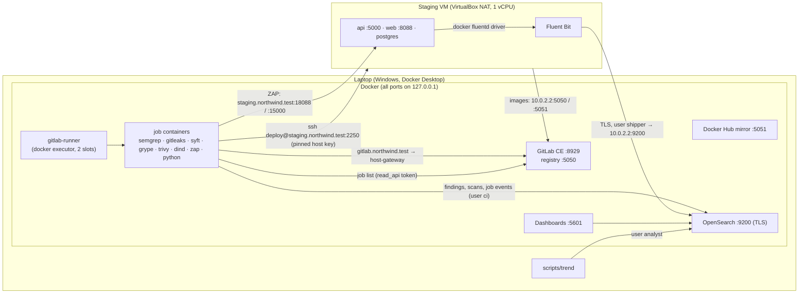
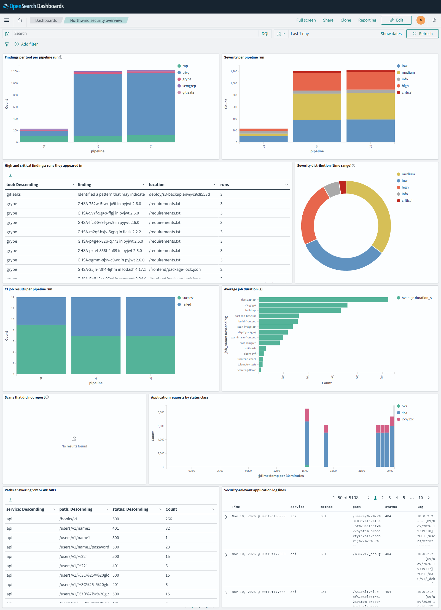

# Submission note

## 1. Summary

This repository is a fork of VAmPI. It has a Postgres back end, a deliberately vulnerable web client and a pen-test summary (`docs/BASELINE.md`, `docs/PENTEST_SUMMARY.md`). It runs a security pipeline on a local GitLab CE with a Docker runner, all brought up by idempotent scripts:

- **Gates.** SAST, secrets, SCA, SBOM and image scanning, each with a documented threshold.
- **Staging.** A Vagrant VM receives an SSH deploy and is scanned by ZAP twice: a passive baseline of the web client and an authenticated active scan of the API.
- **Telemetry.** An OpenSearch stack receives scanner findings, CI job events and the VM's application logs. A tested Python CLI reports trends from it, and a dashboard shows the same data.

Five sets of findings are fixed, and the trend report shows them resolved between pipelines #30 and #31. The pipeline is still red, honestly: the cross-site scripting in the web client, the hard-coded `SECRET_KEY`, `debug=True`, old Flask and PyJWT, base-image packages and the leaked AWS key in history are not fixed (§9).

## 2. How to run it

Prerequisites:
- 16 GB RAM, Docker Desktop with about 10 GB for its VM, VirtualBox 7 and Vagrant 2.4, Git Bash on Windows (or bash on Linux or macOS).
- One hosts-file line: `127.0.0.1 gitlab.northwind.test`. The preflight check prints the exact command.

```bash
scripts/gitlab-up.sh        # GitLab CE, registry, Docker Hub mirror, runner, project, first pipeline
                            # first run 10-15 min (GitLab boot ~5 min); re-run: ~1 min
scripts/telemetry-up.sh     # OpenSearch + Dashboards, CA, users, templates, dashboard, CI variables (~3 min)
scripts/staging-up.sh       # VM, deploy key, pinned host key, Fluent Bit credentials (first run ~10 min)
scripts/gitlab-up.sh        # again, so the next pipeline has every CI variable; waits for the pipeline (~30 min)
scripts/trend --since 7d    # trend report as the read-only analyst
```

Steady-state memory use:
- GitLab, about 4 GB;
- OpenSearch, 768 MB heap in a 1.6 GB container limit, plus Dashboards with a 768 MB limit;
- the VM, 1.5 GB and one vCPU;
- during a pipeline, up to two jobs at once (dind builds, ZAP at about 1 GB).

A full pipeline takes 25–30 minutes. Most of that is the bounded ZAP active scan (up to 12 minutes) and the image scans.

After the first image pulls everything works offline (§4, "Offline"). Tear-down: `scripts/gitlab-down.sh [--purge]`, `scripts/telemetry-up.sh --down|--purge` and `scripts/staging-up.sh --destroy`.

Generated secrets live in `.local/` (git-ignored):
- the GitLab root password and token;
- the deploy key and the pinned host key;
- the telemetry CA and one password per telemetry account.

## 3. Architecture



How things reach each other. One set of host names resolves differently depending on where it is used:
- **Host:** the names resolve to loopback.
- **Job containers:** the Docker host gateway, through the runner's `extra_hosts`, maintained by `gitlab-up.sh`.
- **Staging VM:** VirtualBox NAT's `10.0.2.2`, which is the host's loopback.

Nothing listens beyond loopback, and no host-only network exists (docs/STAGING.md).

## 4. Pipeline and gates

Stages: `test` (gates, unit tests, telemetry tests) → `build` → `scan` → `deploy` → `dast` → `report`. Every gate writes its full report (all severities) to `reports/`, uploads it even when it fails, and only then applies its threshold. The full rationale is in `docs/SECURITY_GATES.md`.

| Gate | Tool | Scope | Fails when | Justification | Artefact |
|---|---|---|---|---|---|
| SAST | Semgrep 1.95.0, 6 registry rulesets + `.semgrep/northwind.yml` | Python, JS, Dockerfiles, YAML; `tests/` and vendored JS excluded | any ERROR finding, **or a rule timed out on a file** | ERROR is reserved for high-confidence, high-impact patterns; WARNING-level audit rules are too noisy with no one to triage. The project rules exist because the registry rules found none of the pen-test SQLi or XSS. | `semgrep.json` |
| Secrets | Gitleaks 8.21.2 | every commit on every branch and tag | any finding | a credential in history is exploitable whatever its severity | `gitleaks.json` |
| SBOM | Syft 1.18.1 | `requirements.txt`, `frontend/package-lock.json` | — | input to SCA, CycloneDX for consumers | `sbom.cdx.json` |
| SCA | Grype 0.99.1 | the SBOM | High/Critical **with a fix**; DB older than 30 days | a developer can act on a fixed vulnerability today; blocking on unfixed ones teaches people to suppress wholesale | `grype.json` |
| Image | Trivy 0.57.1 | each built image (OS and language packages, secrets in layers) and its Dockerfile | High/Critical with a fix; any secret; High/Critical misconfiguration | same reasoning; running as root is the misconfiguration that matters | `trivy-image-*.json`, `trivy-config-*.json`, image SBOMs |
| DAST web | ZAP 2.16.1 baseline | web client on staging | any Medium or above | passive alerts are near-certain and cheap to fix | `zap-baseline.json/.html` |
| DAST API | ZAP 2.16.1 API scan, authenticated, active | every operation in the deployed OpenAPI definition | any High; **or no response from `/users/v1` and `/books/v1`** | active Mediums need human confirmation; High is injection | `zap-api.json/.html` |

**False positives** are suppressed narrowly, next to the configuration, each with an S-number, a reason and an expiry, and listed in `docs/SECURITY_GATES.md`:
- **S-01:** the example JWT in the OpenAPI spec. Gitleaks allowlists the exact value, and Semgrep has a `nosemgrep` with the rule id.
- **S-02:** ZAP's false SQL injection on `PUT /users/v1/{username}/password`. It is suppressed for that URL only, until 2027-02-09.

Disabling a rule, or ignoring a path to make a finding go away, is not allowed.

**Fail closed, not open.** Three gates once passed on scans that had tested nothing; each now fails instead:

| Problem | What happened | Fix |
|---|---|---|
| ZAP API scan reached no endpoint | the first version hit only 404s and the gate passed | coverage check |
| Semgrep skipped whole files on timeouts | `frontend/public/app.js` in #27 and `app.py` in #29: their findings vanished silently | `--timeout-threshold 0`, plus a COVERAGE failure |
| Grype read an eight-month-old DB | Grype 0.86 accepted it without complaint | Grype 0.99.1, which enforces the 30-day age limit |

**Offline.** The scanners' rule sets and databases live in the CI cache. The cache uses one named volume shared by the runner slots, and it is saved even from failing jobs. Every job tries to refresh and falls back to the cache. This was tested with a pipeline whose update sources were all unreachable (#23 against #22): the verdicts were identical. In that test Trivy's databases were still fresh, so only the Semgrep and Grype fallbacks were actually exercised.

## 5. Staging and DAST

**VM.** `staging/Vagrantfile` with `staging/vm/provision.sh`, both idempotent:
- `bento/debian-12`, pinned;
- Docker from download.docker.com, pulling through the host's registry and mirror;
- a key-only `deploy` user; password and root SSH logins disabled;
- a per-VM Postgres password generated on the VM, so it never appears in git or in CI;
- Fluent Bit with the telemetry CA and the shipper password.

The VM has one vCPU on purpose. With Docker Desktop installed, VirtualBox runs on top of Hyper-V, and a 2-vCPU guest stalled for good under load (`rcu_preempt self-detected stall`). The deploy job then hung for the runner's full hour. It now has a 15-minute timeout and SSH keep-alives.

**Deploy** (`deploy-staging`, protected branches only, because the SSH key is a protected variable):
1. scp the compose file to the VM;
2. `docker login` with the job's own token on stdin;
3. pull by commit tag and `docker compose up --wait`;
4. log out;
5. re-seed the data and smoke-check the API and the web client.

`StrictHostKeyChecking=yes` checks against the host key pinned by `staging-up.sh`. The deploy and both scans share the `staging` resource group, so nothing redeploys in the middle of a scan.

**DAST.** A passive baseline of the web client finds almost nothing the pen test found, so the API scan copies the testers' method. `ci/dast_session.py`:
1. registers its own user;
2. logs in;
3. seeds a book with markup in its title;
4. saves the deployed OpenAPI definition with staging as its server and without `/createdb`.

ZAP imports that definition, sends the bearer token with every request, and attacks every operation, URL path segments included (`scanner.injectable=19`).

Getting there took four fixes, each of which would otherwise have left a scan that looked fine and tested nothing (docs/STAGING.md):
- the scan never reached an endpoint;
- `/createdb` deleted the scan's own user;
- a false SQLi on login;
- PT-01 was never attacked, because it sits in a path segment.

**Pen-test findings against DAST**, from the reports of pipelines #29–#31:

| PT | Finding | DAST | Notes |
|---|---|---|---|
| PT-01 | SQLi in `GET /users/v1/{username}` | **detected** (API scan, High) | only after path segments were made injectable |
| PT-14 | headers, version disclosure, directory listing | **detected** (baseline: CSP, anti-clickjacking, nosniff, `Server`) | directory listing not reported |
| PT-16 | outdated JS libraries | **detected** (baseline: Vulnerable JS Library) | |
| PT-13 | Werkzeug debug server | partly | only as "Server leaks version information" |
| PT-11 | ReDoS on e-mail update | **triggered, not reported** | the active scan sent such an address and hung the API at 91 % CPU until restarted; no alert. Seen only as the API going silent. |
| PT-02 | `_debug` lists every user's password | missed | reached (200), but no rule judges response content |
| PT-03 | change anyone's password | missed | ZAP did change `name1`'s password mid-scan and then raised a false SQLi (S-02); the application logs show it (502 successful password changes in one run) |
| PT-04, PT-05 | mass assignment, BOLA | missed | authorisation logic needs two users and business context |
| PT-06 | guessable JWT key | missed | no ZAP rule brute-forces HMAC keys |
| PT-07 | stored and DOM XSS | missed | the API returns JSON; the passive baseline does not execute the client with the seeded data |
| PT-08 | unauthenticated `/createdb` | excluded | the deploy job calls it without credentials, which is the proof |
| PT-09, PT-10, PT-12, PT-15 | user enumeration, no rate limit, plain-text passwords, token in localStorage | missed | PT-10 is visible in the logs (537 failed logins in one run); PT-15 is caught by Semgrep instead (WARNING) |

So ZAP covers injection and HTTP hygiene. The authorisation flaws, the more serious half of the list, need targeted tests: two users, then an assertion that one cannot act on the other's resources. §9 covers this.

## 6. Telemetry

Full description: `docs/TELEMETRY.md`. Dashboard screenshot: `docs/dashboard.png`.

**Indices:**

| Index | Content |
|---|---|
| `findings-YYYY.MM` | one finding per pipeline run |
| `scans-YYYY.MM` | one per scan per run, including scans with no report |
| `ci-jobs-YYYY.MM` | one per job attempt |
| `app-logs-YYYY.MM.DD` | log lines from the VM |

Index templates pin keyword fields. Retention is 30 days for logs and 180 days for pipeline data (ISM). Monthly indices for pipeline data are enough at this volume; daily indices for logs make retention a cheap delete.

**How each stream gets in:**
1. **Findings.** The `telemetry-report` job runs last, even when gates failed. It pulls every scanner's artefacts and normalises them into one shape: tool, scan, rule, severity, location, package and versions, fix available, CVE or CWE, suppression. Fingerprints are stable across runs: they ignore line numbers, image tags, the DAST user and ZAP's payloads. ZAP URLs fold into the OpenAPI path template they match; without that, one API scan was 4,165 "findings" instead of 71. A scan with no report, or with a Semgrep timeout, is recorded as `missing` or `incomplete`, never as zero findings. Secret values are dropped.
2. **Job events.** The same job reads this pipeline's jobs, retried attempts included, from the GitLab API with a `read_api` project token. It records name, stage, commit, ref, status, duration, queue time, failure reason and runner. Document ids are fixed, so a re-run overwrites instead of duplicating.
3. **Application logs.** Docker's fluentd driver on the VM sends to Fluent Bit. Fluent Bit strips ANSI colours (Werkzeug colours its lines, which defeated the parser), parses nginx and Werkzeug access lines, and ships them over verified TLS. A filesystem buffer covers OpenSearch outages; logs buffered before the stack existed arrived once it came up.

**Access.** The demo security configuration was rejected: its key is public and its extra users have published passwords. The stack has its own CA, and every client verifies the certificate. Each writer has its own account:
- `shipper` may only append to `app-logs-*`;
- `ci` may write pipeline data but cannot read logs;
- `analyst` is read-only.

The roles were checked: every out-of-scope request gets 403, and an anonymous one gets 401.

**Trend tool:** `scripts/trend --since 7d|24h|2026-11-01 --format table|json [--ref B] [--compare OLD NEW] [--top N]`. It shows:
- findings per tool per run, with `-` when a tool gave no complete report;
- the severity distribution, for the newest run and for the window;
- new, recurring and resolved findings between two runs, leaving out scans that are missing from either run;
- application-log signals: failed logins per client, 5xx paths, 401/403 paths, injection-looking requests (and how many got a 2xx answer), calls to the debug endpoint, `/createdb`, password changes and user deletions, scanner user agents, and services that went silent.

There are 39 unit tests, standard library only, run in the `telemetry-tests` job.



## 7. Fixes

All five sets were fixed in commit `f4afcfb`, pipeline #31, against #30. The full trend output is in `docs/trend-30-to-31.txt`.

| Finding | Gates that reported it | Fix |
|---|---|---|
| SQL injection in the user lookup (PT-01) | Semgrep `sqli-string-built-query`; ZAP SQL Injection (High) | bound parameter (`models/user_model.py`); regression tests for three payloads |
| E-mail ReDoS (PT-11) | none: it hung staging during DAST | linear pattern, input capped at 254 characters; regression test (the old pattern needed 10.7 s for 29 characters) |
| API container as root | Trivy AVD-DS-0002; Semgrep `missing-user` ×2 | `USER 10001`; base image pinned to `python:3.11.17-alpine3.24` |
| Web client on `nginx:1.21` (Debian 11.3) as root, no security headers, directory listing | Trivy: 1,014 findings, 164 of them High/Critical with fixes; AVD-DS-0002; ZAP baseline: CSP, anti-clickjacking, nosniff, `Server` version | `nginxinc/nginx-unprivileged:1.30.6-alpine` (uid 101, port 8080); `autoindex off`, `server_tokens off`; CSP `'self'`, X-Frame-Options, nosniff, Referrer-Policy, Permissions-Policy, COOP |
| jQuery 3.4.1, lodash 4.17.15, moment 2.24.0 | Grype; ZAP Vulnerable JS Library (High and Medium) | 3.7.1, 4.17.21, 2.30.1. Really fixed: 7 advisories (lodash 3 of 5, moment 2, jQuery 2) and both ZAP alerts. Two lodash advisories also affect 4.17.21 (see "new" below) |

The trend report (`scripts/trend --ref master --compare 30 31`):

```
pipeline  time (UTC)        commit    ref     semgrep  gitleaks  grype  trivy  zap
31        2026-11-09 18:58  eb27aab8  master       16         1     18     94  104
30        2026-11-09 18:30  fb01723a  master       19         1     24   1053  107

#30 -> #31: 85 new, 148 recurring, 1056 resolved
tool      new  recurring  resolved
gitleaks    0          1         0
grype       3         15         9
semgrep     0         16         3
trivy      57         37      1016
zap        25         79        28
```

Among the resolved findings (full list in the evidence file):

```
high    dast:api             SQL Injection                     GET /users/v1/{username}
high    sast                 northwind.python.sqli-string-built-query   models/user_model.py
high    sast                 missing-user / missing-user-entrypoint     Dockerfile
high    dockerfile:api       AVD-DS-0002 Image user should not be 'root'
high    dockerfile:frontend  AVD-DS-0002 Image user should not be 'root'
high    sca                  GHSA-35jh-r3h4-6jhm, GHSA-p6mc-m468-83gw (lodash 4.17.15)
high    sca                  GHSA-8hfj-j24r-96c4, GHSA-wc69-rhjr-hc9g (moment 2.24.0)
high    dast:web             Vulnerable JS Library             /vendor/moment.min.js
medium  dast:web             CSP Header Not Set, Missing Anti-clickjacking Header, Vulnerable JS Library (jquery)
low     dast:web             Server Leaks Version Information, X-Content-Type-Options Header Missing (all paths)
image:frontend: 1014 resolved
```

Both DAST gates went green in #31. The API scan covered 5,700 URLs and the coverage check passed; the only High left is the S-02 false positive.

What the "new" column means. It is not regressions, and it is not hidden:
- **Trivy, 57 new.** The new base image is Alpine 3.24.2, which carries curl, expat, musl, zlib and brotli fixes that are newer than the image. They still block the image gate. The fix is the next upstream image, or `apk upgrade`, but the build containers here cannot reach the Alpine CDN reliably.
- **Grype, 3 new.** Two lodash advisories, GHSA-r5fr-rjxr-66jc and GHSA-xxjr-mmjv-4gpg, also affect 4.17.21; they need a later release, so the bump did not fix them. They appear as resolved for 4.17.15 and new for 4.17.21 because the version is part of the fingerprint. The third is a moment 2.30.1 advisory (GHSA-4p3w-j4w9-5jqw). The lodash bump fixed three of its five advisories, not all of them.
- **ZAP, 25 new.** Rules that never finished before. While the ReDoS hung the API, the active scan ran into its time limit. With the API answering, rules such as Buffer Overflow and Format String (Medium) now complete.

One more caveat about reading the table: #29's Semgrep count of 18 was an incomplete scan, shipped before the `incomplete` status existed.

## 8. Design decisions

| Decision | Chosen | Rejected alternatives | Why |
|---|---|---|---|
| Base project | fork of VAmPI plus a web client, Postgres and a pen-test summary (`docs/BASELINE.md`) | waiting for the original repository | it was not provided; VAmPI has known, documented vulnerabilities to measure the gates against |
| How everything finds GitLab | one name, `gitlab.northwind.test`, resolved per context (loopback, host gateway, `10.0.2.2`) | `host.docker.internal`; a shared Docker network for jobs | Docker Desktop pins `host.docker.internal` to the LAN address, which goes stale offline; one name also works from the VM |
| Runner to VM | VirtualBox NAT port forwards on loopback, reached through host-gateway | host-only network; bridged | exposes nothing beyond the laptop and needs no Docker-to-VirtualBox route, which differs per OS |
| VM CPUs | 1 vCPU | 2 vCPUs | the 2-vCPU guest stalled for good under Hyper-V (NEM) |
| Deploy credentials | protected file variables: an SSH key and a pinned known_hosts; registry login with the job token, then logout | password; `StrictHostKeyChecking=no`; a long-lived registry token on the VM | nothing reusable is left on the VM; the job refuses to talk to an impostor |
| SAST rules | registry rulesets plus small project rules | registry only; CodeQL | the registry rules missed every pen-test SQLi and XSS; CodeQL is not open source for private use |
| SCA and image thresholds | High/Critical **with a fix** | any High; CVSS ≥ 7 | blocking on unfixed CVEs blocks everyone on what nobody can change |
| DAST | baseline (Medium) plus authenticated active API scan (High), with a coverage check | baseline only; full scan of the web client | the pen test found almost nothing with an unauthenticated crawl |
| Telemetry security | own CA, TLS verified everywhere, one account per writer | security plugin disabled on loopback; the demo certificates | the demo key is public and its users have known passwords; with the plugin off, any container could rewrite the history the trend relies on |
| Job events | read in the report job through the GitLab API (`read_api` project token) | webhook receiver service; polling from the host | no extra service to run; misses only pipelines cancelled before the report stage, which is acceptable here |
| Finding identity | own fingerprints per tool; ZAP URLs folded to OpenAPI templates | the tools' own ids; one document per ZAP instance | tags, line numbers and payloads would make every run look new |
| Trend tool | standard-library Python, server-side aggregations, a `Store` layer mocked in tests | `opensearch-py`; client-side processing of raw documents | runs offline in any Python image; testable without a server |
| Dashboard | saved objects generated from code, imported by the script | built by hand in the UI | reviewed like code; survives a purge |

## 9. What I did not do

- **Not fixed:**
  - XSS in the web client (PT-07, 6 Semgrep ERRORs);
  - hard-coded `SECRET_KEY` and the guessable JWT key (PT-06), `debug=True` (PT-13);
  - Flask 2.2.2 and PyJWT 2.6.0 (Trivy and Grype High/Critical); PyJWT needs code changes;
  - the authorisation flaws PT-02 to PT-05, PT-09, PT-10 and PT-12.

  Each is a code change in the application, not pipeline work, and five sets were enough to show the loop. The leaked AWS key in history (Gitleaks) needs rotation, not a code change: it is synthetic here, so I left it as the standing example of a history finding.
- **No authorisation tests in DAST.** ZAP cannot find BOLA. The fix is a scripted two-user test, in the pipeline, that asserts 403s. It would turn PT-03 and PT-05 into gate failures.
- **No structured security events in the application.** The application logs only access lines and tracebacks. Behind VirtualBox NAT every client is `10.0.2.2`, so per-client signals are degenerate. Forwarding `X-Forwarded-For` and logging login, password-change and admin events as JSON (the Fluent Bit parser for that is already in place) would make the log analysis far sharper.
- **No alerting.** Nothing pages anyone when logs go silent or failed logins spike. The trend report shows both, but only when someone runs it. OpenSearch Alerting is installed and unused.
- **No real-time detection of hung services.** The ReDoS hang showed only as silence; a health-check probe with a log line would catch it.
- **Unpinned packages in provisioning.** Docker CE and the compose plugin are installed at whatever version download.docker.com serves.
- **Unsigned baseline tag.** The `baseline` tag is not signed (no GPG key available); commits are not signed either.
- **No stretch goals.** No Cosign signing, no OPA/Conftest, no MobSF.
- **Telemetry TLS is verified, but Dashboards is plain HTTP on loopback**, with a non-Secure cookie.
- **Thin offline test.** The offline fallback was tested once, and only while Trivy's databases were fresh.

## 10. Scaling question

What breaks first is not compute but **triage**. One security engineer cannot own 60 repositories' gate failures, and my design leans on exactly that person:
- suppressions are hand-written with S-numbers in each repository;
- thresholds are per repository;
- a trend report is something someone has to run.

At 20 teams that becomes 60 drifting copies of `.gitlab-ci.yml` and `.semgrep/`, a queue of "please approve my suppression" requests, and pressure to lower thresholds wherever a team is blocked. The single-node OpenSearch and the one laptop runner would also give out. Both are the easy part: scale the runners, run a small OpenSearch cluster.

I would change four things:
1. **One versioned pipeline.** Ship the gates as a GitLab CI component that every repository includes, and express thresholds as policy-as-code (OPA/Conftest), so a change is one reviewed merge request.
2. **Ownership moves to teams.** Each team triages its own findings, with SLAs per severity. Suppressions are self-service but expire, and are audited centrally from the telemetry. The `suppressed` field and the S-numbers already exist for that.
3. **Telemetry becomes the security engineer's job description.** Across all repositories, that person watches:
   - which teams' findings are ageing;
   - which rules produce mostly suppressions, so they can be tuned or dropped;
   - which repositories stopped reporting: the `missing` scans.
4. **Gate on new findings in merge requests**, while existing debt stays visible on the dashboard. That debt is burned down by SLA, not by red pipelines.

## 11. Time log

Approximate, reconstructed from commit times. Pipeline runs (25–30 minutes each) account for much of the "actual" time, spent waiting rather than working.

| Task | Planned | Actual | Notes |
|---|---|---|---|
| 1. Environment | 1–2 h | ~2.5 h | Git Bash path conversion, dind and the plain-HTTP registry, BuildKit ignoring the mirror, `host.docker.internal` going stale |
| 2. Gates | 2–3 h | ~2.5 h | registry Semgrep rules found nothing; Grype 0.86's eight-month-old DB; per-slot runner caches; Trivy's Java DB |
| 3. VM and DAST | 2–2.5 h | ~3.5 h | the ZAP API scan that tested nothing (four fixes); VM stalls under Hyper-V |
| 4. Telemetry | 2–3 h | ~3 h | OpenSearch security configuration (Dashboards server user, strict X.509 for Python 3.13+); ZAP URL folding; Semgrep timeouts found through the trend data |
| 5–6. Fixes and note | 1–1.5 h | ~1.5 h | ReDoS found because the scan hung staging |
