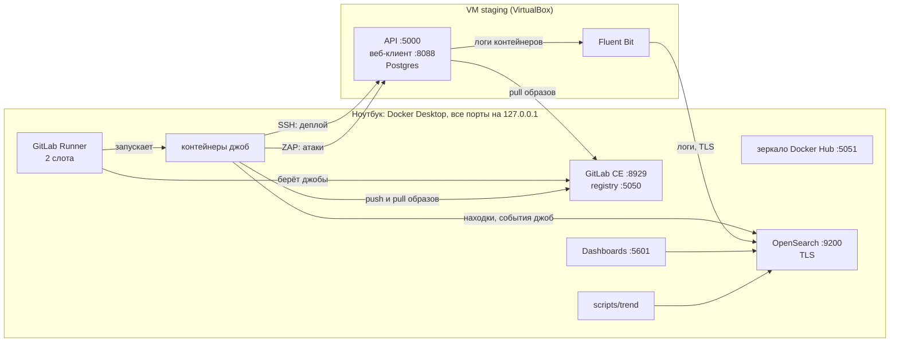
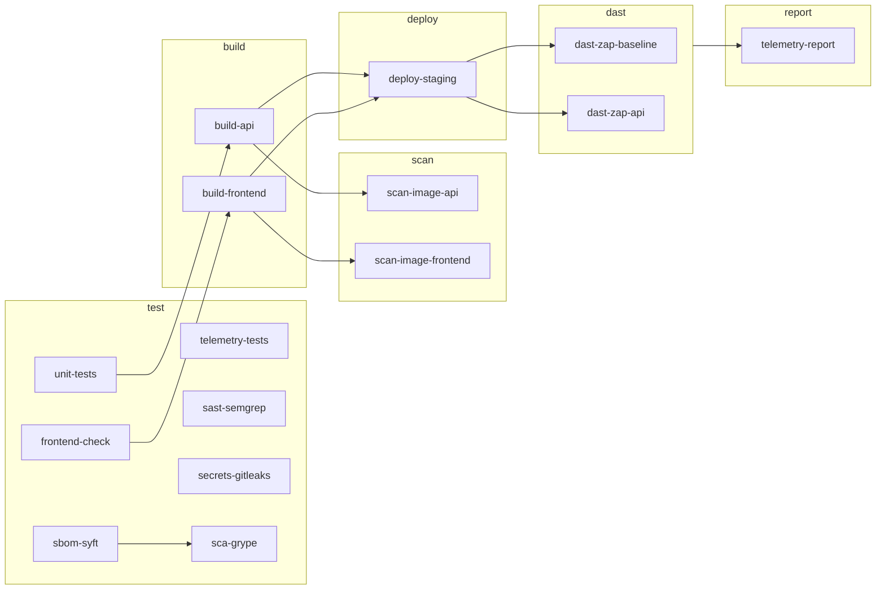
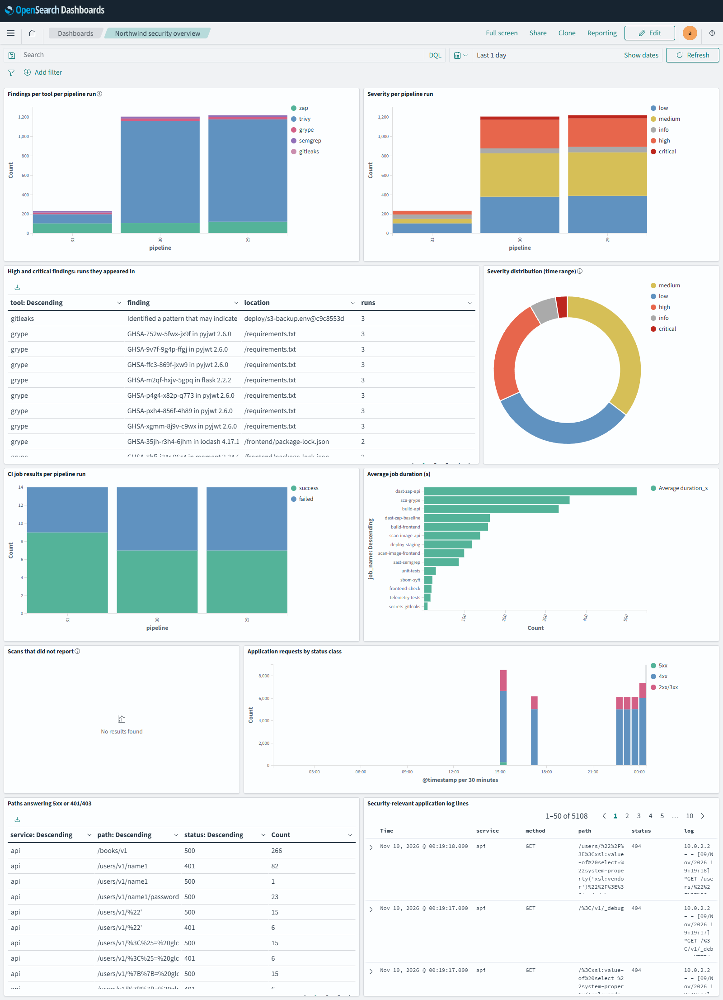

# DevSecOps-конвейер для VAmPI на одном ноутбуке

Этот репозиторий — реализация CI/CD с проверками безопасности: локальный GitLab, конвейер с гейтами, staging-VM с DAST, телеметрия в OpenSearch и отчёт трендов. Всё поднимается скриптами с нуля на одной машине (Docker и одна VM), без платных и облачных сервисов, и после первой загрузки образов работает офлайн.

Проверяемое приложение — форк [VAmPI](https://github.com/erev0s/VAmPI), намеренно уязвимого REST API на Flask. История исходного проекта сохранена, тег `baseline` отмечает исходное состояние. Поверх VAmPI добавлено то, что нужно по сценарию задания:

- база Postgres вместо SQLite;
- веб-клиент на jQuery с намеренными уязвимостями (XSS, токен в `localStorage`, устаревшие библиотеки);
- синтетический ключ AWS, добавленный и удалённый в истории git, — чтобы было что искать сканеру секретов;
- отчёт пентеста, написанный для упражнения: [docs/PENTEST_SUMMARY.md](docs/PENTEST_SUMMARY.md).

- Записка к сдаче (на английском) — [NOTE.md](NOTE.md)
- Порядок запуска, зависимости, снос стенда и разбор неполадок — [docs/RUNBOOK.ru.md](docs/RUNBOOK.ru.md)
- Пороги гейтов и реестр подавлений — [docs/SECURITY_GATES.md](docs/SECURITY_GATES.md)
- Staging-VM и DAST — [docs/STAGING.md](docs/STAGING.md), телеметрия — [docs/TELEMETRY.md](docs/TELEMETRY.md)
- Чем форк отличается от исходного VAmPI — [docs/BASELINE.md](docs/BASELINE.md)

> **Внимание.** Приложение уязвимо специально. Не разворачивайте его в интернете или в общей сети.

## Что сделано

- **Стенд из трёх скриптов.** Идемпотентные скрипты поднимают GitLab с раннером, staging-VM и телеметрию. Повторный запуск ничего не ломает и только доводит стенд до нужного состояния.
- **Гейты безопасности в каждом прогоне:** SAST, секреты во всей истории git, SBOM, SCA, сканирование образов и Dockerfile, DAST по развёрнутому приложению. Отчёты сохраняются артефактами даже при красном гейте.
- **Деплой на staging-VM по SSH** с закреплённым host key. Образы VM берёт из registry GitLab.
- **Два DAST-скана:** пассивный обход веб-клиента и активный аутентифицированный скан всех операций API по OpenAPI.
- **Телеметрия:** находки всех сканеров в общей схеме, события джоб и логи приложения с VM попадают в OpenSearch. Отчёт трендов сравнивает прогоны между собой.
- **Исправления, подтверждённые трендами:** шесть наборов уязвимостей закрыты, и отчёт трендов показывает их как исправленные.

## Архитектура



- **Порты.** Всё слушает только `127.0.0.1`, снаружи ноутбука ничего не видно. Host-only сети у VM нет.
- **Одно имя — разные адреса.** `gitlab.northwind.test` на хосте разрешается в `127.0.0.1`, в контейнерах джоб — в адрес хоста (host-gateway), на VM — в `10.0.2.2` (так VM в VirtualBox видит хост).
- **До VM** джобы добираются через проброс портов VirtualBox: `2250` (SSH), `18088` (веб-клиент), `15000` (API).
- **Секреты.** Пароли, ключи и сертификаты генерируют скрипты в каталог `.local/`, который не попадает в git. В CI они лежат в protected-переменных, пароли ещё и masked. Пароль Postgres генерируется на самой VM и её не покидает.

## Пайплайн



Сборка зависит только от тестов, поэтому упавший гейт не останавливает деплой и DAST. Джоба `telemetry-report` выполняется всегда (`when: always`), после всех остальных, и собирает отчёты всех джоб.

| Стадия | Джоба | Инструмент | Что делает | Гейт падает, если | Артефакты |
|---|---|---|---|---|---|
| test | `unit-tests` | pytest, Postgres | тесты API, включая регрессионные на исправленные уязвимости | тест не прошёл | — |
| test | `frontend-check` | Node | установка зависимостей и `npm test` веб-клиента | тест не прошёл | — |
| test | `telemetry-tests` | unittest | 40 тестов кода телеметрии | тест не прошёл | — |
| test | `sast-semgrep` | Semgrep | SAST по Python, JS, Dockerfile и YAML | есть `ERROR` или правило не уложилось в таймаут | `semgrep.json` |
| test | `secrets-gitleaks` | Gitleaks | секреты во всей истории всех веток и тегов | есть любая находка | `gitleaks.json` |
| test | `sbom-syft` | Syft | SBOM по `requirements.txt` и `package-lock.json` | — | `sbom.cdx.json`, `sbom.syft.json` |
| test | `sca-grype` | Grype | SCA по SBOM | High или Critical **с исправлением**; база старше 30 дней | `grype.json` |
| build | `build-api`, `build-frontend` | Docker | сборка образов и отправка в registry | — | — |
| scan | `scan-image-*` | Trivy | ОС-пакеты и библиотеки образа, секреты в слоях, Dockerfile | High или Critical с исправлением; любой секрет; High или Critical в Dockerfile | `trivy-image-*.json`, `trivy-config-*.json`, `sbom-image-*.cdx.json` |
| deploy | `deploy-staging` | ssh, Docker Compose | деплой на VM по тегу коммита, проверка, что API и веб-клиент отвечают | приложение не поднялось | — |
| dast | `dast-zap-baseline` | OWASP ZAP | пассивный обход веб-клиента | есть `Medium` и выше | `zap-baseline.json`, `.html` |
| dast | `dast-zap-api` | OWASP ZAP | активный скан API с токеном по OpenAPI | есть `High`; скан не дошёл до `/users/v1` и `/books/v1` | `zap-api.json`, `.html` |
| report | `telemetry-report` | Python | находки и события джоб в OpenSearch, отчёт трендов | — (не гейт) | `trend.txt`, `trend.json` |

Часть уязвимостей оставлена неисправленной (раздел [Ограничения](#ограничения)), поэтому пайплайн заканчивается статусом `failed`, и это ожидаемо. Тесты, сборка, деплой, оба DAST-гейта и телеметрия зелёные. Красные `sast-semgrep`, `secrets-gitleaks`, `sca-grype` и `scan-image-*`: это результат проверки, а не сбой.

## Инструменты и версии

Все версии зафиксированы явно: в `.gitlab-ci.yml`, `scripts/lib.sh`, `staging/` и `telemetry/`. Тегов `latest` нет.

### Платформа

| Инструмент | Версия | Где задана | Зачем |
|---|---|---|---|
| GitLab CE | `gitlab/gitlab-ce:19.4.5-ce.0` | `scripts/lib.sh` | репозиторий, CI/CD, Container Registry |
| GitLab Runner | `gitlab/gitlab-runner:alpine-v19.4.2` | `scripts/lib.sh` | выполняет джобы (docker executor, 2 слота) |
| Docker Registry | `registry:2.8.3` | `scripts/lib.sh` | зеркало Docker Hub для работы офлайн |
| Docker-in-Docker | `docker:20.10.16-dind` | джобы `build-*` | сборка образов |

### Проверки безопасности

| Инструмент | Версия | Джоба |
|---|---|---|
| Semgrep | `semgrep/semgrep:1.95.0` | `sast-semgrep` |
| Gitleaks | `zricethezav/gitleaks:v8.21.2` | `secrets-gitleaks` |
| Syft | `anchore/syft:v1.18.1-debug` | `sbom-syft` |
| Grype | `anchore/grype:v0.99.1-debug` | `sca-grype` |
| Trivy | `aquasec/trivy:0.57.1` | `scan-image-*` |
| OWASP ZAP | `zaproxy/zap-stable:2.16.1` | `dast-zap-*` |

### Staging и телеметрия

| Инструмент | Версия | Где задана | Зачем |
|---|---|---|---|
| VirtualBox | 7.2 (на хосте) | — | staging-VM |
| Vagrant | 2.4 (на хосте) | — | создание и настройка VM |
| Debian | `bento/debian-12` версии `202510.26.0` | `staging/Vagrantfile` | ОС на VM |
| OpenSearch | `opensearchproject/opensearch:2.19.6` | `telemetry/compose.yml` | хранилище находок, событий и логов |
| OpenSearch Dashboards | `opensearchproject/opensearch-dashboards:2.19.6` | `telemetry/compose.yml` | дашборд |
| Fluent Bit | `fluent/fluent-bit:3.1.9` | `staging/vm/telemetry-compose.yml` | отправка логов приложения с VM |
| Python | `python:3.12-alpine` | джоба `telemetry-report` | код телеметрии, только стандартная библиотека |

### На чём проверено

| Что | Версия |
|---|---|
| Хост | Windows 11, 16 ГБ RAM |
| Docker Desktop | WSL 2 |
| Оболочка | Git Bash |

Скрипты написаны на bash без Windows-специфичных утилит, поэтому на macOS с Docker Desktop должны работать так же, но это не проверялось. На Linux с нативным Docker Engine стенд в текущем виде не заработает (подробно в [NOTE.md](NOTE.md), §9).

## Как развернуть

Нужны:

- 16 ГБ RAM;
- Docker Desktop, ему нужно около 10 ГБ памяти;
- VirtualBox 7 и Vagrant 2.4;
- bash с `git`, `curl`, `openssl`, `ssh` и `python3` (на Windows — Git Bash);
- строка `127.0.0.1 gitlab.northwind.test` в файле hosts;
- интернет при первом запуске.

```bash
scripts/gitlab-up.sh         # GitLab, registry, зеркало, раннер, проект (первый раз 10–15 минут)
scripts/telemetry-up.sh      # OpenSearch, Dashboards, пользователи, дашборд (около 3 минут)
scripts/staging-up.sh        # staging-VM, ключ деплоя, CI-переменные (первый раз около 10 минут)
scripts/gitlab-up.sh --run   # полный пайплайн (около 15 минут)
scripts/trend --since 7d     # отчёт трендов
```

Первый пайплайн стартует сам при импорте репозитория, ещё до VM и телеметрии, поэтому в нём нет деплоя, DAST и телеметрии. Полный пайплайн запускает `gitlab-up.sh --run` после двух других скриптов.

Что делает каждый скрипт, как остановить и снести стенд, какие файлы создаются и что делать при ошибках — в [docs/RUNBOOK.ru.md](docs/RUNBOOK.ru.md).

## Где смотреть результаты

| Что | Где |
|---|---|
| Пайплайн, отчёты сканеров, SBOM | http://gitlab.northwind.test:8929 → проект → Build → Pipelines → артефакты джоб. Вход: `root`, пароль в `.local/root-password` |
| Находки, события джоб, логи приложения | OpenSearch Dashboards: http://127.0.0.1:5601, дашборд «Northwind security overview». Вход: `analyst`, пароль в `.local/telemetry/analyst-password` |
| Тренды между прогонами | `scripts/trend --since 7d` или `scripts/trend --ref master --compare 30 31` |
| Приложение на staging | веб-клиент http://127.0.0.1:18088, API http://127.0.0.1:15000 |



## Что исправлено

| Уязвимость | Какие гейты её нашли | Исправление |
|---|---|---|
| SQL-инъекция в поиске пользователя (PT-01) | Semgrep, ZAP | параметризованный запрос, регрессионные тесты |
| Смена чужого пароля (PT-03) | ни один: нашлась по нестабильному DAST-гейту | 403, если запрос не от владельца и не от администратора |
| ReDoS в проверке e-mail (PT-11) | ни один: вешал staging во время DAST | линейное регулярное выражение, ограничение длины |
| Контейнер API от root | Trivy, Semgrep | непривилегированный пользователь, закреплённый базовый образ |
| Веб-клиент на старом nginx от root, без защитных заголовков | Trivy (1014 находок), ZAP | `nginx-unprivileged`, CSP и другие заголовки, листинг каталогов выключен |
| Устаревшие jQuery, lodash, moment | Grype, ZAP | обновлены до актуальных версий |

Подробности и вывод отчёта трендов «до и после» — в [NOTE.md](NOTE.md), §7.

## Ключевые решения

- **Свои правила Semgrep.** Стандартные наборы правил не нашли ни одной SQL-инъекции и XSS из отчёта пентеста. Поэтому в `.semgrep/northwind.yml` добавлены узкие правила под паттерны этого кода.
- **Пороги только по исправимому.** SCA и сканирование образов блокируют High и Critical, только если исправление уже вышло. Блокировка на том, что исправить нельзя, приучает команду подавлять всё подряд. Неисправимое видно в отчётах и трендах.
- **Гейт не проходит, если ничего не проверил.** DAST падает, если скан не дошёл до эндпоинтов API. Semgrep падает, если правило не уложилось в таймаут и пропустило файл. Grype падает на базе старше 30 дней.
- **Аутентифицированный DAST.** Пентест показал, что обход без входа почти ничего не находит. Поэтому `ci/dast_session.py` регистрирует пользователя, получает токен, и ZAP атакует все операции из OpenAPI, включая сегменты пути.
- **Узкие подавления.** Ложное срабатывание подавляется в одном месте, с номером, причиной и сроком, и записывается в [docs/SECURITY_GATES.md](docs/SECURITY_GATES.md). Отключать правило целиком запрещено.
- **Своя защита телеметрии.** Демо-конфигурация OpenSearch отвергнута: её приватный ключ и пароли общеизвестны. У стека свой CA, TLS проверяется везде, у каждого писателя своя учётная запись с минимальными правами.
- **Отпечатки находок.** Отпечаток не учитывает номера строк, теги образов и полезные нагрузки ZAP, а URL сводятся к шаблонам из OpenAPI. Без этого один скан ZAP давал 4165 «находок», а каждый прогон выглядел новым.
- **«Нет отчёта» не значит «ноль находок».** Скан, не оставивший отчёта, записывается как `missing` и не участвует в сравнении. Упавший сканер не превращается в «всё исправлено».
- **Офлайн после первой загрузки.** Базы и правила сканеров лежат в кеше раннера, образы — в локальном зеркале. Каждая джоба пробует обновиться и при неудаче берёт кеш.
- **VM с одним vCPU.** VirtualBox работает поверх Hyper-V, и гость с двумя vCPU под нагрузкой зависал намертво.

Все решения с отвергнутыми альтернативами — в [NOTE.md](NOTE.md), §8.

## Ограничения

- **Не исправлены** XSS в веб-клиенте, слабый ключ подписи JWT, `debug=True`, устаревшие Flask и PyJWT, уязвимые пакеты базовых образов и синтетический ключ AWS в истории git. На них гейты и падают.
- **Нет тестов авторизации.** ZAP не находит ошибки доступа к чужим объектам, для них нужны отдельные тесты с двумя пользователями.
- **Нет алертинга.** Тренды показывают аномалии, но только когда отчёт кто-то запускает.
- **Все запросы в логах приходят с одного адреса** — NAT VirtualBox, реальный адрес клиента не виден.
- **Создание VM с нуля требует интернета** (пакеты Debian и Docker). Деплой и повторная настройка работают офлайн.
- **Dashboards работает по HTTP**, хотя и только на `127.0.0.1`.

Полный список — в [NOTE.md](NOTE.md), §9.

## Структура репозитория

```
.gitlab-ci.yml          пайплайн
.semgrep/               свои правила Semgrep
.gitleaks.toml          настройки Gitleaks и подавление
.trivyignore.yaml       подавление для Trivy
.zap/                   подавления для ZAP
ci/                     логика гейтов и подготовка DAST-сессии
scripts/                скрипты стенда и CLI трендов (docs/RUNBOOK.ru.md)
staging/                VM: Vagrantfile, настройка, compose приложения, Fluent Bit
telemetry/              compose и конфигурация OpenSearch
tools/nwtelemetry/      код телеметрии: нормализация, отправка, тренды, дашборд
tools/tests/            тесты телеметрии
app.py, api_views/,     API (Flask)
models/, config.py
frontend/               веб-клиент (nginx и статические файлы)
tests/                  тесты API
docs/                   гейты, staging, телеметрия, отчёт пентеста, выводы trend, скриншот дашборда
NOTE.md                 записка к сдаче
ASSIGNMENT.md           текст задания
```

## Лицензия

MIT, как и у исходного VAmPI, — см. [LICENSE](LICENSE).
