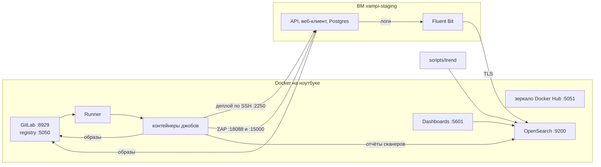
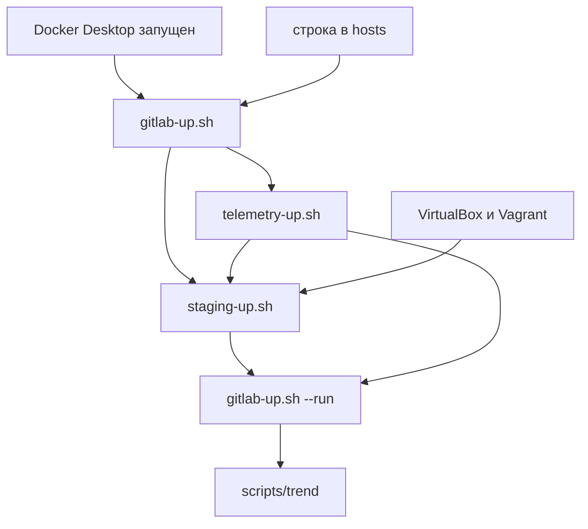

# Как работает стенд, что от чего зависит и как его поднимать

Этот документ отвечает на три вопроса:

1. Из чего состоит стенд и как части связаны между собой.
2. Что от чего зависит и что сломается, если какая-то часть не работает.
3. Как поднять, проверить, остановить и починить стенд.

Краткое описание проекта — в [README.md](../README.md).

---

## 1. Из чего состоит стенд

Всё работает на одном ноутбуке. Частей четыре: три группы контейнеров в Docker и одна виртуальная машина в VirtualBox.

| Часть | Что входит | Чем поднимается |
|---|---|---|
| **GitLab** | GitLab CE (код, пайплайны, registry образов), GitLab Runner, зеркало Docker Hub | `scripts/gitlab-up.sh` |
| **Телеметрия** | OpenSearch (хранилище) и Dashboards (веб-интерфейс) | `scripts/telemetry-up.sh` |
| **Staging** | ВМ `vampi-staging` с Docker: API, веб-клиент, Postgres, Fluent Bit | `scripts/staging-up.sh` |
| **Джобы пайплайна** | временные контейнеры, которые Runner создаёт на каждый джоб | запускает сам GitLab |



### Что происходит при каждом пайплайне

1. `scripts/gitlab-up.sh` отправляет код в GitLab, и GitLab создаёт пайплайн.
2. Runner запускает джобы, каждый в своём контейнере. Одновременно идут не больше двух.
3. Стадия `test`: тесты и сканеры исходного кода (Semgrep, Gitleaks, Syft, Grype).
4. Стадия `build`: собираются образы API и веб-клиента и отправляются в registry GitLab.
5. Стадия `scan`: Trivy проверяет оба образа.
6. Стадия `deploy`: джоб заходит на ВМ по SSH, ВМ скачивает образы из registry и перезапускает приложение.
7. Стадия `dast`: OWASP ZAP сканирует приложение на ВМ.
8. Стадия `report`: джоб `telemetry-report` собирает отчёты всех сканеров и отправляет их в OpenSearch.

Параллельно, вне пайплайна, Fluent Bit на ВМ постоянно отправляет логи приложения в OpenSearch.

### Порты

Все порты слушают только `127.0.0.1`. В локальную сеть ничего не открыто.

| Порт | Что на нём |
|---|---|
| 8929 | GitLab (веб и API) |
| 5050 | registry образов GitLab |
| 5051 | зеркало Docker Hub |
| 9200 | OpenSearch (HTTPS) |
| 5601 | Dashboards |
| 2250 | SSH на ВМ |
| 18088 | веб-клиент на ВМ |
| 15000 | API на ВМ |

### Как части находят друг друга

Одно и то же имя разрешается в разные адреса в зависимости от того, откуда идёт запрос.

| Имя | С ноутбука | Из контейнера джоба | С ВМ |
|---|---|---|---|
| `gitlab.northwind.test` | 127.0.0.1 (строка в hosts) | адрес хоста (host-gateway) | 10.0.2.2 |
| `staging.northwind.test` | — | адрес хоста (host-gateway) | — |
| `telemetry.northwind.test` | 127.0.0.1 | адрес хоста (host-gateway) | 10.0.2.2 |

- **host-gateway** — адрес, по которому контейнер видит ноутбук. Имена прописывает `gitlab-up.sh` в настройках Runner.
- **10.0.2.2** — адрес, по которому ВМ в VirtualBox видит ноутбук.
- До ВМ джобы добираются через проброс портов VirtualBox: 2250, 18088 и 15000.

---

## 2. Что от чего зависит

### Зависимости при первом подъёме

Порядок запуска скриптов задан тем, что каждый следующий использует результат предыдущего.



| Скрипт | Что ему нужно | Что он даёт другим |
|---|---|---|
| `gitlab-up.sh` | Docker, строка в hosts | GitLab, registry, Runner, токен API в `.local/root-token` |
| `telemetry-up.sh` | работающий GitLab (кладёт в него CI-переменные) | OpenSearch, свой CA, пароли, CI-переменные `TELEMETRY_*` |
| `staging-up.sh` | работающий GitLab; CA и пароль `shipper` от телеметрии; VirtualBox и Vagrant | ВМ, ключ деплоя, CI-переменные `STAGING_*` |
| `gitlab-up.sh --run` | все CI-переменные уже созданы | полный пайплайн |
| `scripts/trend` | OpenSearch и хотя бы один завершённый пайплайн | отчёт трендов |

**Почему первый пайплайн неполный.** Джобы `deploy-staging`, `dast-*` и `telemetry-report` запускаются, только если существуют их CI-переменные. При первом запуске `gitlab-up.sh` переменных ещё нет, поэтому этих джобов в пайплайне нет. Полный пайплайн запускает `gitlab-up.sh --run` после двух остальных скриптов.

**Что будет, если запустить `staging-up.sh` раньше `telemetry-up.sh`.** ВМ поднимется и деплой будет работать, но Fluent Bit не получит CA и пароль, и логи приложения не дойдут до OpenSearch. Исправляется повторным запуском `staging-up.sh` после `telemetry-up.sh`.

### Зависимости внутри пайплайна

| Джоб | Что ему нужно | Что будет, если этого нет |
|---|---|---|
| все джобы | GitLab, Runner, зеркало Docker Hub | пайплайн не запустится или джоб не скачает образ |
| `sca-grype` | отчёт `sbom-syft` | джоб упадёт |
| `build-api` | успешный `unit-tests`, registry GitLab | при упавших тестах образ не собирается |
| `build-frontend` | успешный `frontend-check`, registry GitLab | при упавшей проверке образ не собирается |
| `scan-image-*` | образы из `build-*` | джоб упадёт |
| `deploy-staging` | работающая ВМ, образы в registry, переменные `STAGING_*` | джоб упадёт за 15 минут или быстрее |
| `dast-*` | успешный `deploy-staging` | джобы не запустятся |
| `telemetry-report` | OpenSearch, переменные `TELEMETRY_*` | джоб упадёт; сканы останутся без записи в телеметрии |

Два правила, которые полезно помнить:

- **Упавший гейт не останавливает пайплайн.** Сборка зависит только от тестов, поэтому сборка, деплой и DAST идут дальше, а `telemetry-report` запускается в любом случае. Так красный прогон тоже попадает в тренды.
- **Сканеры работают и без интернета.** Базы уязвимостей и правила хранятся в кеше Runner. Джоб сначала пробует обновить базу, а при неудаче берёт копию из кеша.

### Что сломается, если часть стенда не работает

| Не работает | Что перестаёт работать | Что продолжает работать |
|---|---|---|
| Docker Desktop | GitLab, Runner, телеметрия, пайплайны | ВМ и приложение на ней |
| GitLab | пайплайны, деплой (ВМ берёт образы из registry) | приложение на ВМ, телеметрия, `scripts/trend` |
| Runner | джобы висят в статусе `pending` | всё остальное |
| Зеркало Docker Hub | джобы без локальной копии образа | джобы, чьи образы уже скачаны |
| ВМ | `deploy-staging` и DAST | гейты по коду и образам, телеметрия |
| OpenSearch | `telemetry-report`, `scripts/trend`, Dashboards | пайплайн до стадии `report`; логи копятся на ВМ и доедут позже |
| Интернет | создание ВМ с нуля, первое скачивание образов | пайплайны, деплой, телеметрия |

### Где хранится состояние

| Что | Где | Что будет при удалении |
|---|---|---|
| Данные GitLab (проект, пайплайны, образы) | тома Docker | всё создаётся заново, история пайплайнов теряется |
| Кеш сканеров | том `gitlab-runner-cache` | базы скачиваются заново, нужен интернет |
| Данные OpenSearch | том Docker | история находок и логов теряется |
| Пароли, токены, ключи, CA | каталог `.local/` | скрипты генерируют новые; старые данные могут стать недоступны |
| Диск ВМ | VirtualBox | ВМ создаётся заново, нужен интернет |
| CI-переменные | база GitLab | их заново создают `telemetry-up.sh` и `staging-up.sh` |

Каталог `.local/` не попадает в git. Удалять его отдельно от контейнеров нельзя: в нём лежат пароли к уже созданным данным.

---

## 3. Как поднимать стенд

### Один раз перед первым запуском

1. Установите Docker Desktop, VirtualBox 7 и Vagrant 2.4.
2. Выделите ВМ Docker Desktop около 10 ГБ памяти.
3. Добавьте в файл hosts строку `127.0.0.1 gitlab.northwind.test`. На Windows файл лежит в `C:\Windows\System32\drivers\etc\hosts`, править его нужно от имени администратора.
4. Откройте Git Bash в корне репозитория. Все команды ниже выполняются оттуда.

### Первый запуск

```bash
scripts/gitlab-up.sh         # 10–15 минут; сам GitLab стартует около 5 минут
scripts/telemetry-up.sh      # около 3 минут
scripts/staging-up.sh        # около 10 минут; нужен интернет
scripts/gitlab-up.sh --run   # полный пайплайн, около 15 минут
```

Для первого запуска нужен интернет: скачиваются образы Docker, образ ВМ и базы сканеров.

### Запуск после перезагрузки компьютера

Контейнеры и ВМ сами не стартуют. Порядок тот же, но всё проходит быстрее.

```bash
# 1. Запустите Docker Desktop и дождитесь, пока он будет готов.
scripts/gitlab-up.sh --no-wait   # около 5 минут: GitLab стартует долго
scripts/telemetry-up.sh          # около минуты
scripts/staging-up.sh            # 1–2 минуты
scripts/gitlab-up.sh --run       # новый пайплайн, если он нужен
```

Скрипты можно запускать сколько угодно раз. Каждый шаг проверяет, сделан ли он, и печатает `ok`.

### Как запустить пайплайн

| Задача | Команда |
|---|---|
| Отправить новые коммиты и дождаться пайплайна | `scripts/gitlab-up.sh` |
| Отправить коммиты и не ждать | `scripts/gitlab-up.sh --no-wait` |
| Запустить ещё один пайплайн на том же коммите | `scripts/gitlab-up.sh --run` |

В GitLab код отправляет только `gitlab-up.sh`. Обычный `git push` настроен на исходный репозиторий VAmPI на GitHub, и отправка туда намеренно отключена.

### Как проверить, что всё работает

```bash
docker ps --format '{{.Names}}: {{.Status}}'
# должны быть: gitlab (healthy), gitlab-runner, docker-mirror,
#              telemetry-opensearch (healthy), telemetry-dashboards

curl -s http://gitlab.northwind.test:8929/-/readiness      # {"status":"ok",...}
curl -s -o /dev/null -w '%{http_code}\n' http://127.0.0.1:18088/   # 200 — веб-клиент на ВМ
curl -s http://127.0.0.1:15000/                             # ответ API на ВМ
scripts/trend --since 7d                                    # отчёт трендов
```

В браузере:

| Что | Адрес | Вход |
|---|---|---|
| Пайплайны | http://gitlab.northwind.test:8929/root/vampi-devsecops/-/pipelines | `root`, пароль в `.local/root-password` |
| Дашборд | http://127.0.0.1:5601 | `analyst`, пароль в `.local/telemetry/analyst-password` |
| Приложение | http://127.0.0.1:18088 | — |

### Как понять результат пайплайна

Скрипт печатает таблицу джобов и строку `pipeline #N finished with status: failed`. Это нормальный результат. Должно быть так:

| Джобы | Ожидаемый статус |
|---|---|
| `unit-tests`, `frontend-check`, `telemetry-tests`, `sbom-syft` | `success` |
| `build-api`, `build-frontend`, `deploy-staging` | `success` |
| `dast-zap-baseline`, `dast-zap-api`, `telemetry-report` | `success` |
| `sast-semgrep`, `secrets-gitleaks`, `sca-grype`, `scan-image-api`, `scan-image-frontend` | `failed` — на неисправленных уязвимостях |

Если упал джоб из первых трёх строк, это настоящая неполадка: смотрите раздел 5.

---

## 4. Как останавливать

### Остановить с сохранением данных

```bash
scripts/gitlab-down.sh             # GitLab и Runner
scripts/telemetry-up.sh --down     # OpenSearch и Dashboards
cd staging && vagrant halt; cd ..  # ВМ
```

Зеркало Docker Hub (`docker-mirror`) скрипт не останавливает: оно занимает мало памяти. При необходимости — `docker stop docker-mirror`. После этого можно закрыть Docker Desktop. Чтобы освободить и его память, выполните `wsl --shutdown`.

Останавливайте стенд перед выключением компьютера. После аварийного выключения GitLab может долго восстанавливаться, а прерванный пайплайн зависает в статусе `canceling`.

### Удалить полностью

Эти команды необратимы: удаляются данные, пароли и ключи.

```bash
scripts/staging-up.sh --destroy    # удалить ВМ
scripts/telemetry-up.sh --purge    # удалить данные телеметрии, CA и пароли
scripts/gitlab-down.sh --purge     # удалить GitLab, Runner, их данные, кеш сканеров, пароль и токен root
```

`staging-up.sh --destroy` удаляет только ВМ: ключ деплоя и CI-переменные остаются. После `gitlab-down.sh --purge` стенд придётся поднимать с первого шага.

---

## 5. Если что-то не работает

| Симптом | Причина и решение |
|---|---|
| `gitlab-up.sh` падает на проверке имени | нет строки в hosts; скрипт печатает точную команду |
| `gitlab-up.sh` долго ждёт готовности | GitLab стартует 3–6 минут, это нормально; дольше 10 минут — смотрите `docker logs gitlab` |
| Контейнер не стартует: `port is not available` | Windows после перезагрузки зарезервировала этот порт. От администратора: `netsh int ipv4 set dynamicport tcp start=49152 num=16384`, затем перезагрузка |
| `staging-up.sh`: `VirtualBox is not forwarding host port(s)` | та же причина. Быстрый обход: `STAGING_WEB_PORT=28088 scripts/staging-up.sh`, и дальше запускать с той же переменной |
| `gitlab-up.sh` показывает старый пайплайн | на том же коммите он берёт существующий; новый запускает `--run` |
| В пайплайне нет джобов деплоя и DAST | ещё не выполнены `telemetry-up.sh` и `staging-up.sh`; после них — `gitlab-up.sh --run` |
| `deploy-staging` висит, SSH не отвечает | ВМ зависла: `cd staging && vagrant halt -f`, затем `scripts/staging-up.sh` |
| Джобы долго в статусе `pending` | Runner не запущен: `scripts/gitlab-up.sh --no-wait` |
| `trend: cannot query` | OpenSearch не запущен: `scripts/telemetry-up.sh` |
| Dashboards отвечает 503 | он ещё стартует, подождите минуту; иначе — `docker logs telemetry-dashboards` |
| `curl` к OpenSearch: `CERT_TRUST_REVOCATION_STATUS_UNKNOWN` | особенность `curl` в Windows: добавьте `--ssl-no-revoke` |
| В Dashboards нет логов приложения | ВМ поднята раньше телеметрии: повторите `scripts/staging-up.sh` |
| Не хватает памяти | остановите стенд (раздел 4), затем `wsl --shutdown` |

### Сколько памяти занимает стенд

| Часть | Память |
|---|---|
| GitLab | около 4 ГБ |
| OpenSearch | до 1,6 ГБ |
| Dashboards | до 768 МБ |
| ВМ | 1,5 ГБ |
| Джобы во время пайплайна | до 2 ГБ |

---

## 6. Где читать подробнее

| Тема | Документ |
|---|---|
| Гейты, пороги, подавления, работа без сети | [SECURITY_GATES.md](SECURITY_GATES.md) |
| ВМ, деплой, DAST | [STAGING.md](STAGING.md) |
| Телеметрия, права доступа, отчёт трендов | [TELEMETRY.md](TELEMETRY.md) |
| Решения, ограничения и что не сделано | [NOTE.md](../NOTE.md) |
